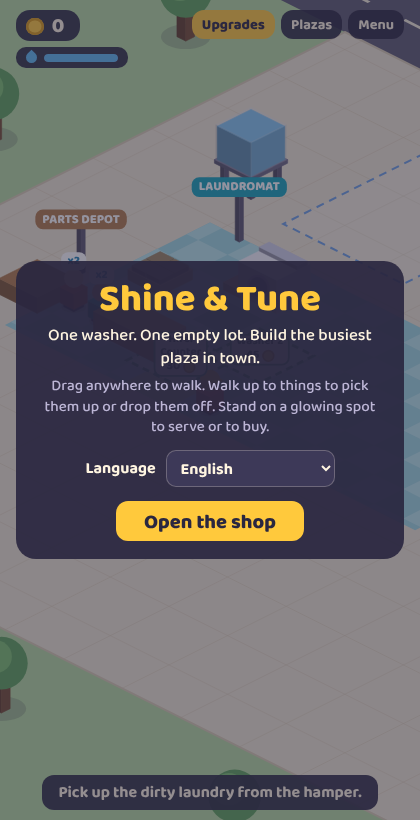
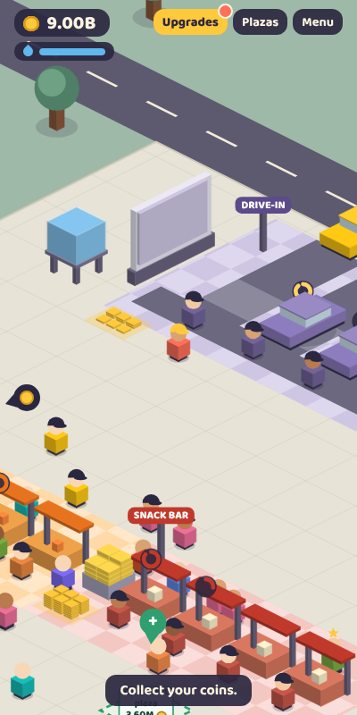
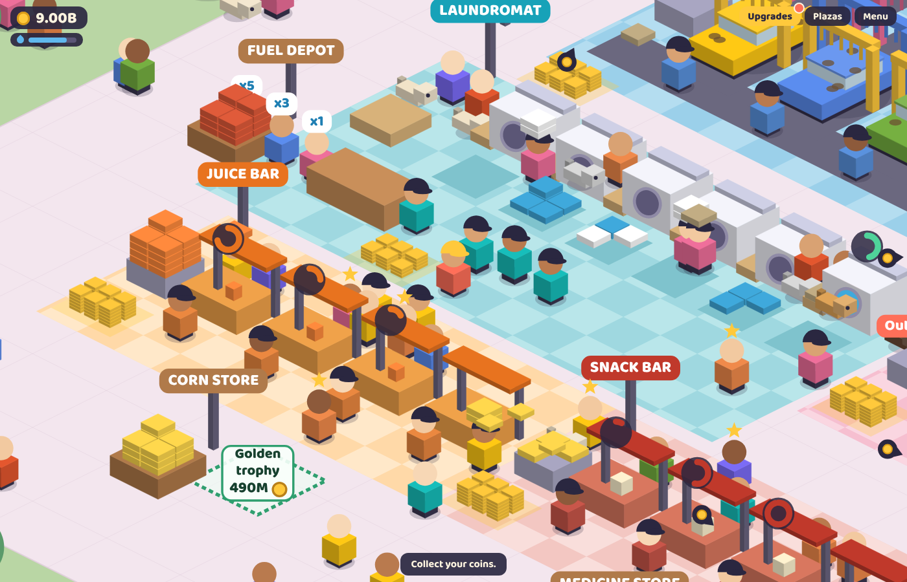
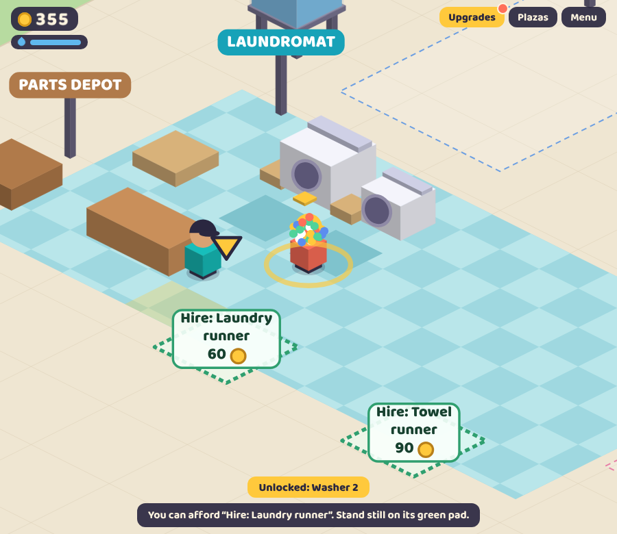

# Shine & Tune

One washer. One empty lot. Build the busiest plaza in town.

A browser game about running a service plaza: you walk around, carry things, serve
customers, buy new stations with the takings, and hire staff who gradually take the
work off your hands. Then you move to the next plaza and do it again with a different
mix of shops.

The whole game is one self-contained HTML file. No engine, no framework, no external
assets — everything is drawn with the canvas 2D API, the sound is synthesised with
WebAudio, and the font is inlined as base64.



## Play

Open `index.html` in any modern browser, or host the file on any static host.

| Action | Phone | Keyboard |
| --- | --- | --- |
| Walk | drag anywhere | arrow keys or WASD |
| Pick up / drop off | walk into the thing | same |
| Serve a customer | stand on the glowing spot | same |
| Buy a plot | stand still on the green plot | same |
| Pause | leave the app | `Esc` |

Progress saves to `localStorage` per plaza. The game pauses when you leave and resumes
where you left off — nothing runs while you are away.

## The shops

Eleven shop types, each with up to four stations and its own speed and price upgrades.
Every station can be worked by you or handed to a hired staff member.

| Shop | Customer | Consumes | Service time | Base price |
| --- | --- | --- | ---: | ---: |
| Laundromat | walk-in | water | 5s per wash | 5 |
| Car wash | car | towel + water | 7s | 22 |
| Fuel station | car | fuel | 4.5s | 17 |
| Car repair | car | parts | 10s | 62 |
| Drive-in theatre | car | — | 20s | 44 |
| Pet salon | pet owner | towel + water | 5.5s | 30 |
| Pet clinic | pet owner | medicine | 9s | 76 |
| Pet playhouse | pet owner | water | 13s | 50 |
| Phone repair | walk-in | parts | 6.5s | 40 |
| Juice bar | walk-in | fruit + water | 4s | 18 |
| Snack bar | walk-in | corn | 3.5s | 13 |

Prices are multiplied per plaza, so a late-game grooming pays far more than an early one.

## The plazas

| # | Plaza | Shops |
| --- | --- | --- |
| 1 | Corner Lot | Laundromat, car wash, pet salon, phone repair |
| 2 | Fuel Row | Fuel station, car wash, car repair |
| 3 | Drive-In Field | Drive-in theatre, juice bar, snack bar |
| 4 | Pet Street | Pet salon, pet clinic, pet playhouse |
| 5 | Market Street | Laundromat, car wash, fuel station, pet salon, juice bar |
| 6 | Grand Plaza | All eleven |



## What makes it tick

**The towel loop.** The car wash and pet salon each burn a clean towel per customer and
drop a dirty one in their bin. If the plaza has a laundromat, those towels go back
through the same washers the laundry customers are queueing for, so the two businesses
compete for one bottleneck. Plazas without a laundromat get a towel store instead.

**One water tank.** Washing machines, car washes, pet baths and the juice press all draw
from a single tank that refills at a fixed rate. Expanding too fast runs it dry.

**Supply runs.** Parts, fuel, fruit, corn and medicine arrive at depots at the edge of
the plaza and have to be carried to each shop's rack. Supply runners head for the
emptiest rack first so no shop starves while another sits full.

**Combo customers.** A customer leaving one shop sometimes walks to another in the same
plaza and pays 50% more, which rewards building shops that sit near each other.



## How it is built

```
src/shell.html   markup, CSS, HUD, sheets
src/body.html    the game: data tables, simulation, renderer, UI
src/build.py     inlines the font subsets and concatenates the two into index.html
tools/sim.py     runs the pacing bot over chosen plazas
tools/calib2.py  binary-searches each plaza's cost curve to hit a target length
```

`index.html` is committed and playable as is. To rebuild it:

```bash
# fetch and unpack the font once
mkdir -p src/font && cd src/font
npm pack @fontsource-variable/baloo-2@5.3.0 && tar xzf *.tgz && cd ../..

python3 src/build.py
```

The renderer is a painter's-algorithm isometric view: every object registers a depth key
of `x + y`, the list is sorted once per frame, then drawn back to front. Floating labels
measure each other and push upwards when they collide, so prices and bubbles never stack
on top of one another.

### The pacing simulator

The part worth a look. Each plaza is meant to take roughly five and a half hours of play,
which is hard to guess by hand across six plazas and about a hundred purchases each.

So the game ships with a headless mode. `window.__paceSim(plaza, gamma, maxHours, m)`
runs the same update loop with rendering off, driven by a bot that always buys the
cheapest thing it can afford, and returns how long the plaza took. Purchase costs follow

```
cost(i) = nice( plazaMultiplier * shape( 30 * 600^(i/n) ) )
```

where `shape` is tuned by two constants per plaza. `tools/calib2.py` binary-searches
those constants, running each candidate several times to average out the randomness,
until the simulated playthrough lands on target. Every balance change gets re-run through
it before shipping.

```bash
python3 tools/sim.py '[[0,0.9],[5,0.9]]'     # time plazas 1 and 6
python3 tools/calib2.py '[0,1,2,3,4,5]' '[0.9]'   # re-tune all six
```

Both scripts drive the page with Playwright and Chromium.



## Other details

- Seven languages: English, Spanish, Portuguese, Hindi, Telugu, Indonesian and Arabic,
  with right-to-left layout for Arabic. The language is guessed from the browser on first
  run.
- Sound effects and the background loop are generated at runtime with oscillators, so
  there are no audio files.
- Renders at the device pixel ratio and drops resolution automatically if frames start
  running long.
- Respects `prefers-reduced-motion`.

## Roadmap

- Wrap as an Android app with Capacitor, lock to portrait, wire up the back button
- Rewarded ads for double cash and instant upgrades
- Play Store closed test, then production
- Have the seven translations checked by native speakers

## Credits

Written from scratch. Inspired by the feel of *Dusty Stop* and *Pizza Ready*; no code or
art is taken from either.

No license has been chosen yet — add one if you want other people to reuse the code.
